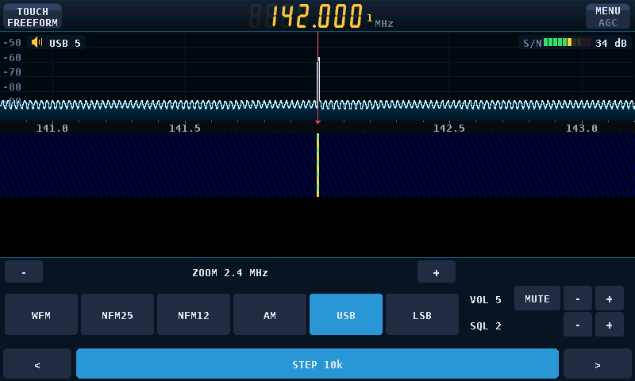

# P4 SDR — Waveshare ESP32-P4-WIFI6-Touch-LCD-4.3

ESP-IDF port of [John O'Dell's P4 SDR v1.2.0](https://github.com/John-ODell/esp32-p4-rtl-sdr/tree/v1.2.0)
for the **Waveshare ESP32-P4-WIFI6-Touch-LCD-4.3** with its 480 × 800 ST7701
MIPI-DSI screen and GT911 touch controller. It adapts the original RTL-SDR
receiver to this integrated display board.
This line is maintained independently: changes are pushed only to this
repository, with no pull or push to the original project. Its original source
attribution and GPL-3.0 license remain. GitHub currently still labels this
repository a fork; leaving the fork network is a separate, irreversible
GitHub account action that removes pull-request and other repository metadata.

The inherited application includes a spectrum/waterfall receiver, AM/FM audio,
RDS, ADS-B aircraft display, channel memories, microSD logging, and Wi-Fi/BLE
scanning through the on-board ESP32-C6. Features beyond the display have not
all been checked on this board. **MENU → LOOK → TURN** cycles the screen and
touch through 0°, 90°, 180° and 270° clockwise from the native portrait
orientation; the choice is saved for the next boot. Four-way rotation has been
confirmed working on the user's rev3 board.

Choose a color scheme through **MENU → LOOK**. The frequency display across the
top no longer cycles themes when tapped. A chosen look is committed to NVS
immediately (rather than after the usual three-second settings delay) and is
loaded for the splash screen on the next boot, including after power removal.
This behavior has host tests and cross-builds; it has not been rechecked on the board.

The waterfall stops above a fixed **156-pixel footer**: a **ZOOM −/+** row
changes the spectrum/waterfall's horizontal span through 2.4 MHz, 1.2 MHz,
600 kHz and 300 kHz (hold to repeat). The vertical dB scale is still under
**MENU → RANGE**. Six mode buttons
(WFM, NFM25, NFM12, AM, USB, LSB) are on the left and **MUTE/UNMUTE**, **VOL −/+**
and **SQL −/+** on the right. Mute silences the speaker without changing the
saved volume or stopping the RF stream; tap again to restore the same level.
Hold the volume/squelch keys to repeat (mute is a single toggle). Volume ranges from
0 (off) to 10 and squelch from 0 (open) to 9; **MENU → AUDIO** also offers
these modes and settings. The two arrows on the **bottom tuning bar** tune by the increment shown on
the highlighted **STEP** button. Tap STEP to cycle **100 Hz, 1, 5, 9, 10, 12.5,
25, 50, 100, 500 kHz, 1 MHz and 5 MHz**; hold either arrow to repeat. The chosen step is
saved; existing saved step IDs retain their original increments. The frequency readout shows the 100 Hz digit when needed; tune SSB to
the suppressed-carrier frequency. Phosphor now uses only the green
RGB565 channel, including its splash and status messages.

On the Waveshare main screen, the **TOUCH** key at the upper left cycles
**FREEFORM → SNAP → PEAK**. Touch-frequency tuning is limited to the **upper
spectrum waveform**: a tap must start and end there. The frequency axis,
waterfall and footer no longer tune when tapped. FREEFORM is the default and
uses the prior mode/zoom-dependent increments; SNAP rounds to the nearest
multiple of the selected bottom-bar **STEP**. PEAK takes the nearest strong
local maximum within 24 screen columns of the press (at least 12 dB above
the displayed noise floor); if none qualifies, it does **not** retune. The
TOUCH mode is temporary and resets to FREEFORM on restart; STEP remains saved.
Host tests cover all looks in landscape/portrait, but physical touch accuracy
and signal selection are not yet board-verified.



These are **host-rendered previews with synthetic RF**, not photos or live
reception results. See the [screenshot gallery](docs/SCREENSHOTS.md) for all
three touch modes, portrait layout, timeout settings and the sensor screens.

The older floating audio controls were reported to flicker on hardware, and
the interface was reported to flash every few seconds. The static footer and
bounded waterfall pass host tests and cross-builds, but **their on-board effect
is not yet confirmed**; if flashing remains, capture the UART log around the
event (especially stream restart and USB error messages). **Set SQL to OPEN
(0) for SSB**: its nonzero power-based squelch may mute speech and does not
discriminate sidebands.

**MENU → RF INPUT** adds Bias-T OFF/ON and direct-ADC TUNER/I/Q choices.
Bias-T supplies about 4.5 V to a **compatible active antenna or LNA** via
the dongle's antenna socket; the firmware commands OFF after every boot or USB
reconnection and does not store ON in settings. A failed USB command leaves
antenna power **unknown**, not confirmed OFF: RF INPUT shows "BIAS ? RETRY OFF"
and its OFF key retries the write. A successful USB write does not measure
antenna voltage; check the socket with a meter if safety depends on it.
Do **not** turn it on with a DC-shorted antenna,
and check your USB power budget—battery operation with this board/dongle has
already browned out. If the dongle's EEPROM forces Bias-T ON, the OFF key is
disabled and the EEPROM setting must be changed separately. The RF page shows
ADC I/Q choices but disables them for the **RTL-SDR Blog V4/V4L**, whose HF
path uses a built-in upconverter instead of direct sampling; simply tune the
V4 to the HF frequency in TUNER mode. On other dongles, I/Q only works if the
corresponding ADC input is physically wired. Direct mode, unlike Bias-T, is
saved and reapplied after device reopen. See the [V4 user's guide](https://www.rtl-sdr.com/v4/).

**MENU → BAND** includes North American receive presets at 315 MHz and
345 MHz (low-power Part 15 devices), 433.92 MHz (the existing 433/70CM slot),
and 915 MHz (within the 902–928 MHz ISM band). The menu is paged (**PREV/NEXT**)
and returns to the waterfall when a preset is selected (ADS-B opens its decoder). It adds AM broadcast starting points at 600/1000/1600 kHz, ten shortwave AM
starting points from 3.95 to 21.6 MHz, and CB channels 1/9/19/40 in AM plus
channel 38 in USB and LSB. Presets tune a **receive-only** frequency and choose
an audio demodulator/filter; they do not guarantee a station or legal authority
to transmit. The Blog V4's built-in HF upconverter remains in **TUNER** mode.
ISM presets are **not** packet decoders. **MENU → SCAN → SENSORS** is a separate,
experimental foreground decoder, initially at 433.92 MHz, for **Fine Offset WH2** weather
and **Steelmate TP-S15-family** TPMS packets only. It uses the existing RTL-SDR
USB/IQ ring; audio and waterfall pause while it listens. EXIT restores the
previous frequency and audio. Tap **BAND MHz >** on the sensors screen to cycle
433.92, 315, 345, 868.30 and **915 MHz**. Changing band discards queued pre-retune
IQ, resets both parsers and clears readings/counts, so one band's data is never
shown as current on another band. Band selection is a temporary **RF center**,
not an added decoder: WH2 remains the narrow named WH2 format, not generic Fine
Offset support; **Fine Offset 915 MHz protocols are not implemented or verified**.
No new 315/345/868/915 device compatibility is claimed. The screen shows decoded IDs/readings, a decoder
load estimate and dropped-IQ bytes; any dropped ring span resets both packet
parsers. Displayed packet rows expire after 60 seconds, while counts remain
totals for the selected-band session. This does **not** decode arbitrary TPMS, weather sensors, or ISM traffic.
Known recorded CU8 examples pass host tests at 250 kS/s. When replayed at
2.4 MS/s, WH2 decodes and Steelmate decodes **two of three** repeated packets;
the third fails a strict preamble check. Live Blog V4 sensitivity, USB
throughput, false-positive behavior and decoding of your own devices have
**not been verified on hardware**. Do not
rely on this experimental TPMS screen for vehicle safety decisions.

Mute, volume and squelch now save together in a versioned NVS audio-control
record immediately on each change, outside the audio task. Previous saved
volume and squelch values are read when that record is absent. The three
controls load before audio is unpaused; mute remains distinct from volume 0.
Failed writes are logged and retried with the latest desired values. Simulated
immediate power-loss, migration, failure and retry host tests pass. The user
also confirms audio-control persistence across power-off/restart on the rev3
board; this is user-reported hardware evidence, not a new board test in this
change. See [ROADMAP.md](ROADMAP.md).

**MENU → SETTINGS → SCREEN TIMEOUT** selects **30 / 60 / 90 seconds / NEVER**
(default NEVER, preserving the previous always-on behavior). Selection commits
immediately to NVS; failed writes are logged and retried, and corrupt stored
values fall back to NEVER. Inactivity blanks the ST7701 output and switches the
PWM backlight off. A tap wakes it, consuming the entire wake gesture through
release so it cannot tune, change a setting or exit a decoder. Touch, shared
I2C, SDR/audio and the MIPI framebuffer remain running; this is **not system
sleep or a complete panel/touch power-rail shutdown**. The BSP's backlight API
only controls LEDC PWM, and the ST7701 MIPI driver's display API sends
DISPOFF/DISPON. The firmware turns off the backlight before DISPOFF and sends
DISPON before lighting it; it never disables shared touch/PHY supplies.
Timeout/wake is serviced in the receiver and foreground modes, and during USB
recovery polling (a blocking dongle reopen may delay a wake by several seconds).
Host state-machine/NVS/power-order tests and rev1/rev3 cross-builds are not proof
of physical backlight current, wake reliability or flash retention: verify the
new timeout and bottom controls on the board before a hardware-support claim.

## Hardware status

| Image | P4 revision | Status on this board |
| --- | --- | --- |
| `p4-sdr-waveshare43-rev3.bin` | v3.1 and newer | **User-flashed older image:** display, RTL-SDR on J3 with USB-supplied power and no battery, and four-way rotation worked. The old floating controls flickered; the new footer and SSB have not yet been verified on board. |
| `p4-sdr-waveshare43-rev1.bin` | v1.x | Cross-compiled; not tested on this board. |

**Battery-power limitation (user report):** with the RTL-SDR connected via J3,
the board browns out when running from its battery. The same setup works with
the battery removed and the board powered from a USB host. An additional power
controller/charge circuit will be required for battery operation; its design and
current budget have **not** been established yet. Do not assume the board's
existing battery path can power the display and dongle together.

The dongle was not detected through a **passive USB-C adapter** on the port
marked **USB**, which does not source USB VBUS in the bare-board setup. J3 works;
that observation does not validate USB-C host-role cabling. Audio, SD logging
and wireless scanning are not being claimed as hardware-verified here.

## USB host connections

The port marked **USB TO UART** is for flashing and serial logs; it cannot host
the RTL-SDR. The port marked **USB** and the J3 header's high-speed USB pins
share the *same* ESP32-P4 USB controller. The existing firmware uses that
controller in host mode for either connection—**no rebuild or firmware switch
is required** to use J3.

| J3 40-pin header | Signal |
| --- | --- |
| 27 | USB D+ (`USBD_P`) |
| 25 | USB D− (`USBD_N`) |
| 26 | GND |
| 1 or 3 | Board 5 V rail |

Verify the header orientation against the board silkscreen and
[Waveshare pinout](https://docs.waveshare.com/ESP32-P4-WIFI6-Touch-LCD-4.3#pinout-definition).
J3 pins 21/23 are a **different**, full-speed USB pair and are not the native
high-speed host data pins used by this firmware. Do not connect a peripheral
to both J3 and the **USB** Type-C socket at the same time. A J3-powered USB-A
breakout needs a suitable current-limited/fused 5 V supply, common ground and
short, paired high-speed data wiring; check the 5 V rail under load first.
Do not bridge the header's 5 V directly into the Type-C connector. A powered
hub alone may not resolve the Type-C host-role/CC wiring. See
[board notes](WAVESHARE-43.md) for additional caveats.

## Flash and build

The firmware images are **full flash images written at address `0x0`**. Match
the image to your P4 silicon revision; a full flash can overwrite saved
settings and memories. `dist/` contains locally generated binaries and is
ignored by Git; cloning this repository alone does not download them.

```sh
python -m esptool --chip esp32p4 -p PORT flash_id
python -m esptool --chip esp32p4 -p PORT -b 921600 write_flash 0x0 dist/p4-sdr-waveshare43-rev3.bin
```

Use `dist/p4-sdr-waveshare43-rev1.bin` instead only for a v1.x chip. Connect
the board's **USB TO UART** port to your computer for flashing and for a
115200-baud serial console. Check images against `dist/SHA256SUMS-waveshare43`.

To build both revisions, install and export **ESP-IDF 5.5.5** with ESP32-P4
tools, then run:

```sh
. "$HOME/esp/esp-idf/export.sh"  # adjust to your ESP-IDF installation
./tools/build_waveshare43.sh
```

The build script generates both images and checksums in `dist/`. See
[WAVESHARE-43.md](WAVESHARE-43.md) for board-specific build settings and
troubleshooting. For the ADS-B map generator, see `tools/mapgen/`.

## Host verification

Run `sh tools/test_controls.sh` with `TMPDIR` pointing to a writable scratch
directory. It compiles the C policy/NVS tests with warnings as errors, checks
firmware UI source-path contracts, and runs the preview hit/geometry/cache tests
for both display configurations in portrait and landscape. Generated test
binaries stay under `$TMPDIR/p4-control-tests`. The source-path guards supplement
rather than replace behavioral C tests or physical touch/power measurements.

The preview supports `--settings-snapshot FILE [--portrait]` and
`--sensor-snapshot FILE --portrait 4` (band index 4 is 915 MHz; no invented
readings are shown there). These are host-rendered examples, not RF evidence.
Recorded WH2/Steelmate fixture replays and the DSP suite are separate tests;
third-party IQ recordings are not included in the repository. The existing
`tools/adsb_test` has a baseline weak-KLM-packet failure (2 messages vs 3 expected),
reproduced from unmodified `ed50f32`; it is not fixed or hidden by this work.

## Credits and license

Original application: [John O'Dell's P4 SDR](https://github.com/John-ODell/esp32-p4-rtl-sdr).
Its ADS-B position tracking incorporates work by
[John Stockdale](https://github.com/jstockdale/T-Display-P4/tree/adsb).
GPL-3.0-or-later; see [LICENSE](LICENSE) and [THIRD_PARTY.md](THIRD_PARTY.md).
