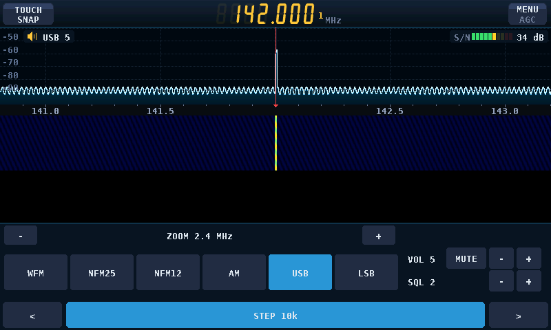
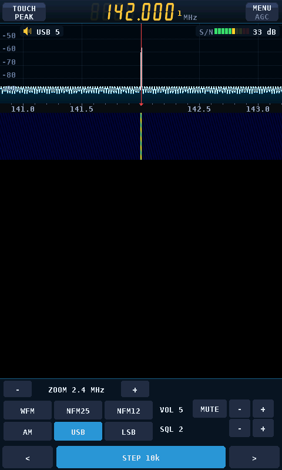
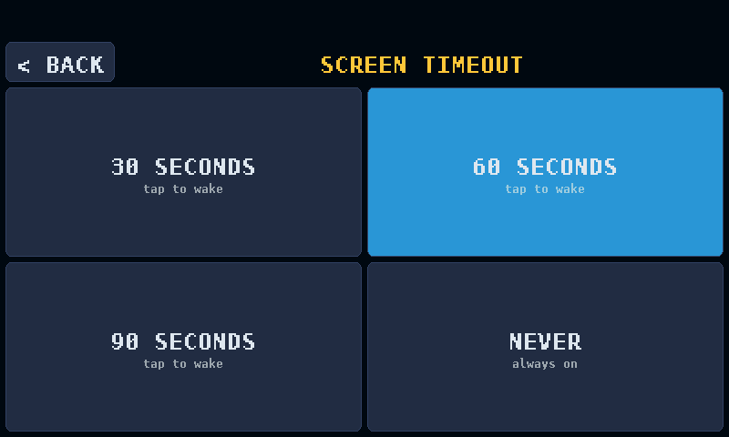
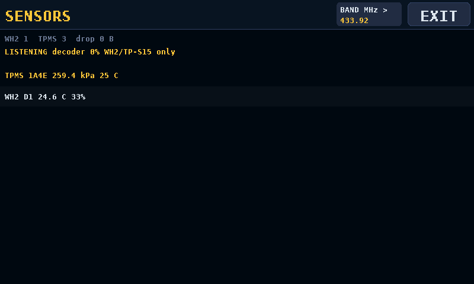
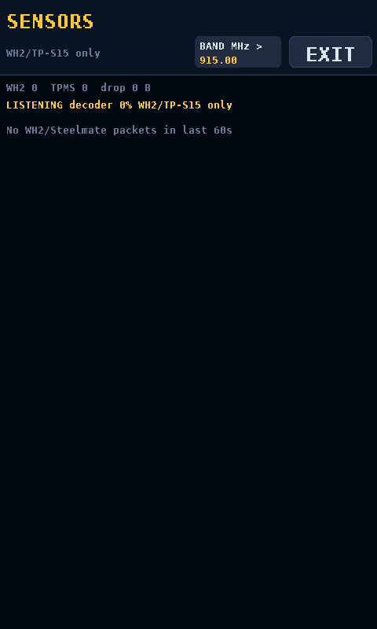

# Waveshare 4.3-inch UI previews

The illustrated firmware is available in the
[RC3 pre-release](https://github.com/pterodyne/esp32-p4-rtl-sdr-waveshare43/releases/tag/waveshare43-touch-rc3).
These PNGs are **host-rendered examples from `tools/preview`**, not photos of a
board and not proof of live RTL-SDR reception. The receiver waveform/waterfall
is synthetic; the 433.92 MHz sensor example uses illustrative fixture-derived
readings, while the 915 MHz view has **zero** packets. Only named WH2 and
Steelmate TP-S15-family decoders are present; selecting 915 MHz does not add a
Fine Offset 915 MHz decoder.

## Main receiver — spectrum-only touch tuning

The top-left TOUCH key cycles **FREEFORM → SNAP → PEAK**; tuning taps must start
and end in the upper spectrum waveform, not the frequency axis or waterfall.
The bottom STEP control is separate from the TOUCH mode.

| Freeform (default) | Snap to selected STEP | Nearest qualifying peak |
| --- | --- | --- |
|  |  |  |

## Settings and sensor screen

| Screen timeout | 433.92 MHz example (illustrative readings) | 915 MHz, no detections |
| --- | --- | --- |
|  |  |  |

Reproduce with `./tools/test_controls.sh`, which builds
`$TMPDIR/p4-control-tests/preview-waveshare43`, then run its
`--audio-snapshot`, `--settings-snapshot` or `--sensor-snapshot` modes. For
example, `--audio-snapshot output.png --peak` renders the Peak key;
`--sensor-snapshot output.png --portrait 4` renders an empty 915 MHz screen.
The real GT911 hit regions, signal-selection accuracy and screen timeout
still need testing on the Waveshare board.
